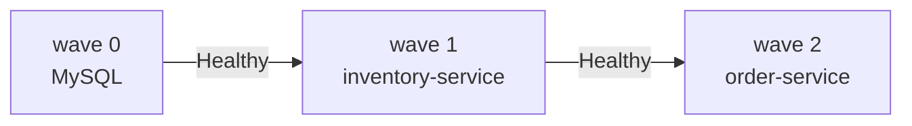

# argocd-inventory-order-app-helm

Argo CD deployment of the inventory-order-app from a **Helm chart**: the
`Application` points at a chart plus values, and Argo CD renders it.

```text
application.yaml                  # the Argo CD Application (apply this once, by hand)
application-dev.yaml              # same chart, dev values, own namespace
inventory-order-app/              # the chart
  values.yaml                     # defaults
  values-dev.yaml                 # overlay: H2 (no MySQL), 1 replica each, no HPA
  values-prod.yaml                # overlay: more replicas, LoadBalancer
  templates/
    mysql.yaml                    # Secrets, PVC, Service, Deployment   (sync wave 0)
    inventory-service.yaml        # Deployment, Service, HPA            (sync wave 1)
    order-service.yaml            # Deployment, Service                 (sync wave 2)
```



## Use

Prerequisite: Argo CD installed —
[installation notes](https://github.com/ramanujds/devops-learning-journey/blob/main/git-ops-argocd/04-argocd-installation.md).

```bash
# preview exactly what Argo CD will apply
helm template inventory-order-app ./inventory-order-app
helm template inventory-order-app ./inventory-order-app -f inventory-order-app/values-prod.yaml

kubectl apply -f application.yaml -n argocd

argocd app get inventory-order-app-helm
kubectl get all -n inventory-order-app-helm
kubectl port-forward svc/order-service -n inventory-order-app-helm 8082:80   # http://localhost:8082
```

- **change values, not templates**: edit `inventory-order-app/values.yaml`,
  push, Argo CD rolls it out
- `mysql.enabled: false` drops MySQL and flips inventory to the `dev`
  (in-memory H2) Spring profile

## Choosing an environment (values-dev.yaml / values-prod.yaml)

Argo CD picks a values file through the Application's `helm.valueFiles`.
The chart's own `values.yaml` is always the base; each file you list is
layered on top of it, and later files win.

| File | What it changes | Result |
| --- | --- | --- |
| `values.yaml` (default) | — | MySQL, `prod` profile, order ×2, inventory on an HPA |
| `values-dev.yaml` | `mysql.enabled: false`, no HPA, 1 replica each, inventory `ClusterIP`, order NodePort 30085 | 4 objects, H2 in memory |
| `values-prod.yaml` | inventory HPA 2–8, order ×3, order `LoadBalancer` | same objects, bigger |

**1. Preview what Argo CD will render** (no cluster needed):

```bash
helm template inventory-order-app ./inventory-order-app -f inventory-order-app/values-dev.yaml
```

**2a. Deploy dev as its own Application** (next to the default app):

```bash
kubectl apply -f application-dev.yaml -n argocd

argocd app get inventory-order-app-helm-dev
kubectl get all -n inventory-order-app-dev
kubectl port-forward svc/order-service -n inventory-order-app-dev 8084:80   # http://localhost:8084
```

The only difference from `application.yaml` is this block (path is relative
to `source.path`, i.e. the chart directory):

```yaml
helm:
  valueFiles:
    - values-dev.yaml
```

**2b. Or switch the existing Application to dev** — edit `valueFiles` in
`application.yaml`, then re-apply it (editing the file in Git alone does
nothing: you applied the `Application` by hand, so Argo CD isn't watching
it):

```bash
kubectl apply -f application.yaml -n argocd
```

Or change the live object directly (it then differs from the YAML, and a
parent app-of-apps with `selfHeal` would revert it):

```bash
argocd app set inventory-order-app-helm --values values-dev.yaml
```

Switching an app from the default to dev prunes MySQL, the PVC (data is
lost) and the HPA, because `prune: true`.

**3. Combine files** — later wins, so a team-specific tweak can sit on top:

```yaml
valueFiles:
  - values-dev.yaml
  - values-dev-eu.yaml        # hypothetical; overrides anything in values-dev.yaml
```

Precedence, lowest to highest: `values.yaml` → `valueFiles` →
`valuesObject` → `parameters`.

**Gotchas**

- a `valueFiles` entry that doesn't exist gives `ComparisonError`; set
  `helm.ignoreMissingValueFiles: true` to make a file optional
- NodePorts are per cluster: default uses 30083/30084, dev uses 30085, so
  all of them fit together; two copies of the *same* values would clash
- a values-file change only takes effect after it's pushed to
  `targetRevision` (`main`)

## Notes

- `helm ls` shows **nothing**: Argo CD only runs `helm template`. History
  and rollback are Argo CD's (`argocd app history|rollback`)
- the inventory Deployment omits `replicas` when the HPA is on, so
  `selfHeal` doesn't fight autoscaling
- the HPA targets memory at 60% of a 256Mi request, which the app exceeds
  on its own, so inventory-service scales up (2+ pods in testing); raise
  `inventoryService.resources.requests.memory` or the target to change that
- NodePorts are 30083 / 30084, so this can run beside the plain-YAML repo
- `mysql.rootPassword` in `values.yaml` is a plaintext demo value — use a
  real secret mechanism for anything beyond a demo

## Clean up

```bash
kubectl delete -f application.yaml
kubectl delete namespace inventory-order-app-helm   # the namespace itself is left behind
kubectl delete -f application-dev.yaml              # if you deployed dev
kubectl delete namespace inventory-order-app-dev
```

Same app as plain YAML: `argocd-inventory-order-app-simple`. Concepts:
[devops-learning-journey/git-ops-argocd](https://github.com/ramanujds/devops-learning-journey/tree/main/git-ops-argocd).
