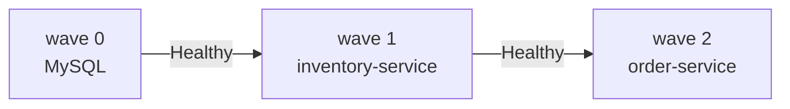

# argocd-inventory-order-app-helm

Argo CD deployment of the inventory-order-app from a **Helm chart**: the
`Application` points at a chart plus values, and Argo CD renders it.

```text
application.yaml                  # the Argo CD Application (apply this once, by hand)
inventory-order-app/              # the chart
  values.yaml                     # defaults
  values-prod.yaml                # overlay: more replicas, LoadBalancer
  templates/
    mysql.yaml                    # Secrets, PVC, Service, Deployment   (sync wave 0)
    inventory-service.yaml        # Deployment, Service, HPA            (sync wave 1)
    order-service.yaml            # Deployment, Service                 (sync wave 2)
```



## Use

Prerequisite: Argo CD installed —
[installation notes](https://github.com/ramanujds/devops-learning-journey/blob/main/git-ops-argocd/04-argocd-installation.md).

```bash
# preview exactly what Argo CD will apply
helm template inventory-order-app ./inventory-order-app
helm template inventory-order-app ./inventory-order-app -f inventory-order-app/values-prod.yaml

kubectl apply -f application.yaml -n argocd

argocd app get inventory-order-app-helm
kubectl get all -n inventory-order-app-helm
kubectl port-forward svc/order-service -n inventory-order-app-helm 8082:80   # http://localhost:8082
```

- **change values, not templates**: edit `inventory-order-app/values.yaml`,
  push, Argo CD rolls it out
- to use the prod overlay add `values-prod.yaml` to `helm.valueFiles` in
  `application.yaml`; for a one-off override use `helm.valuesObject`
- `mysql.enabled: false` drops MySQL and flips inventory to the `dev`
  (in-memory H2) Spring profile

## Notes

- `helm ls` shows **nothing**: Argo CD only runs `helm template`. History
  and rollback are Argo CD's (`argocd app history|rollback`)
- the inventory Deployment omits `replicas` when the HPA is on, so
  `selfHeal` doesn't fight autoscaling
- the HPA targets memory at 60% of a 256Mi request, which the app exceeds
  on its own, so inventory-service scales up (2+ pods in testing); raise
  `inventoryService.resources.requests.memory` or the target to change that
- NodePorts are 30083 / 30084, so this can run beside the plain-YAML repo
- `mysql.rootPassword` in `values.yaml` is a plaintext demo value — use a
  real secret mechanism for anything beyond a demo

## Clean up

```bash
kubectl delete -f application.yaml
kubectl delete namespace inventory-order-app-helm   # the namespace itself is left behind
```

Same app as plain YAML: `argocd-inventory-order-app-simple`. Concepts:
[devops-learning-journey/git-ops-argocd](https://github.com/ramanujds/devops-learning-journey/tree/main/git-ops-argocd).
